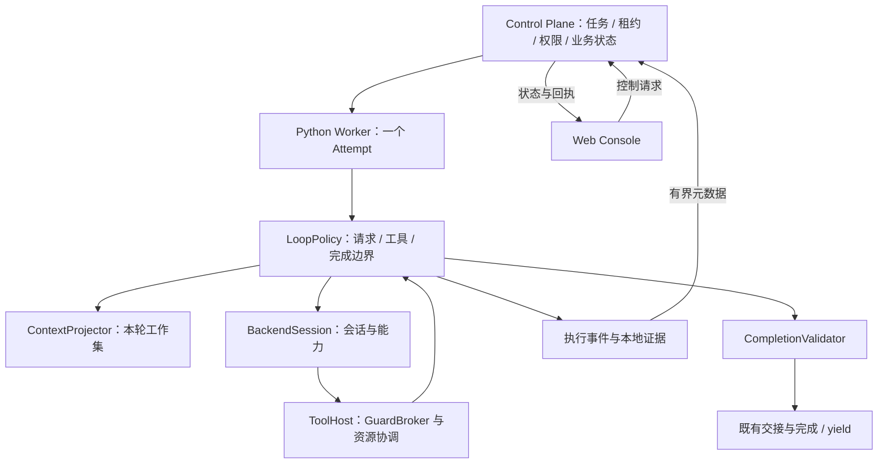

# FD-079: Observable and controllable Python Worker automation loop

**Status:** In Progress
**Revision:** 1
**Review policy:** Independent
**Priority:** Medium
**Evidence policy:** Markdown

## Problem

用户要求 Worker 在明确边界内自主处理开发任务，同时让操作者知道实际在做什么并能控制运行。用户确认：只移植 Pi 的有效机制，以 Python 为主，不安装 Pi、不引入其 JS SDK，保留没有 API Key 时使用 Codex app-server 的路径。

已有研究支持优化每回合上下文工作集、工具往返、有限纠错和执行事件，但本项目尚未测量收益。当前不同后端已经有部分能力，缺少一致的回合、上下文、完成和控制语义。

用户随后明确要求设计完成后直接开始实施。本 FD 先完成设计，再按阶段实施；测试执行、模型调用与部署仍需各自授权。

## Options and decision

| 方案 | 决定及理由 |
| --- | --- |
| 安装 Pi 或接入其 SDK | 不采用，不符合用户的语言与依赖偏好。 |
| 所有后端重写为同一个 Python while 循环 | 不采用，会重复建设 Agents SDK 与 Codex 能力，也不能强迫后端暴露内部请求。 |
| Python 统一回合政策，后端适配器声明实际能力 | 采用。宿主循环和后端循环使用同一组边界规则、工具执行器与完成政策，各自保留明确执行所有者。 |

确定以下不变量：

1. Control Plane 管理任务、租约、任务重试、审批和业务验收；Worker 管理一个 attempt 内的执行。
2. 每个模型请求及工具动作只有一个执行所有者；后端驱动推理不等于获得任意工具权限。
3. 正常任务自主推进，缺少必要输入、授权或遇到终止条件时明确等待或停止。
4. 先记录每回合输入和消耗，再优化；不承诺外部评测中的提速或节费比例。
5. 工具权限、资源协调、租约检查和不确定副作用核对不因优化而放宽。
6. 新能力显式版本化；不改写历史报告、不接管旧进程、不自动重跑历史任务。

## Solution

### 1. 当前事实与设计落点

以下来自静态阅读，不代表运行验证。

| 当前代码 | 已有事实 | 本 FD 的设计落点 |
| --- | --- | --- |
| `agent_runtime.py` | `AgentRunRequest`、`AgentRuntime.run` 隔离后端，一次调用返回报告文本 | 保留外层调用入口，内部增加有生命周期的会话适配器和共同回合政策。 |
| `guarded_text_runtime.py` | 每轮一个 action，每轮新建调用环境并拼接 observations；部分格式错误直接终止 | 同 attempt 会话复用、规范消息、工具批次、有限格式纠错。 |
| `guarded_app_server.py` | dynamicTools 经 Broker 执行，同 thread/turn 可处理多个工具 | 复用能力，补齐控制边界、上下文可见范围和候选校验。 |
| `openai_api_runtime.py`、`context_window.py` | SDK、调用上限、usage、结果截断引用、历史压缩已经存在 | 接入统一政策；完成校验移到输入窗口封闭之前。 |
| `operator_inputs.py`、`ExecutionWorkbench` | STEER/FOLLOW_UP、预留、MODEL 关联、DELIVERED、FINALIZING 已存在 | 保留原队列与回执，不创建第二套补充输入事实。 |
| `worker_runtime.py`、`execution_guard.py` | 期限、取消、证据、操作授权与资源不确定状态已存在 | 扩展有限事件，不以观测接口替代授权操作记录。 |
| `QuestionContract`、`formal_questions.py` | 提问/yield 已存在，但 v1 checkpoint 强制 Git，Python 仍引用旧 workspace 字段 | 与 FD-078 对接 location/handoff 恢复，不能直接声称适用任意目录。 |

未验证：已安装 Codex 各版本的续行、动态工具、门控、usage 与终止保证；同条件性能；真实 UI、多实例和故障恢复。适配器不能以模型自述作为能力证据。

### 2. 职责与结构



名称表示职责，不要求拆成独立服务。建议新增 `automation_loop.py`、`run_contract.py`、`completion_validation.py`，上下文、证据和输入队列优先扩展已有模块。

| 职责 | 负责内容 | 明确边界 |
| --- | --- | --- |
| LoopPolicy | 边界检查、输入交付、纠错计数、候选完成和收尾顺序 | 不调度 Plan、不重新派发 attempt、不扩大授权。 |
| ContextProjector | 规范消息投影、来源、工作集、压缩 | 摘要不能创造事实或修改冻结目标。 |
| BackendSession | 连接、流消息、续行、取消、资源终态 | 不静默换模型、provider 或权限。 |
| ToolHost | 参数校验、逐动作授权、资源协调、实际结果 | 模型描述不能证明工具完成。 |
| CompletionValidator | 输出结构、报告语义一致性、证据引用与完成前置条件 | 不替代独立阶段评审，不把 REPAIR_REQUIRED 改成 PASS。 |
| RunObservation | 显示已观察事件、时间、上下文、usage | 不创造成功、价格或授权事实。 |

### 3. 后端能力与执行所有者

每次 attempt 冻结 `RuntimeCapabilities`，同时记录适配器版本、后端版本和预检依据：

```text
protocol: aiw.worker.loop.v1
requestLoopOwner: HOST | BACKEND
toolExecutor: HOST | BACKEND
contextVisibility: PROVIDER_PAYLOAD | WORKER_PROJECTION | BACKEND_OPAQUE
dispatchBoundary: TOOL | BATCH | TURN | NONE
supplementBoundary: REQUEST | TURN | NONE
sessionReuse: SAME_ATTEMPT | NONE
pauseBoundary: TOOL | BATCH | TURN | NONE
cancelEvidence: CONFIRMED | BEST_EFFORT
usageScope: REQUEST | CUMULATIVE | UNKNOWN
requestAccountingScope: REQUEST | BACKEND_TURN | UNKNOWN
```

| 路径 | 请求循环 / 工具执行 | 要求 |
| --- | --- | --- |
| Python host-action + Codex model-only | HOST / HOST | 禁用且确认原生副作用工具，Python 决定下一模型调用和实际动作。 |
| Codex dynamicTools + Broker | BACKEND / HOST | 后端驱动推理，全部外部工具回调经过 Python 门控；内部请求不可见时标注。 |
| Agents SDK + 受控工具 | BACKEND / HOST | 用已有模型包装与工具钩子接入共同政策，保留 SDK 历史契约。 |
| Codex 原生工具 | BACKEND / BACKEND | 观察和粗粒度控制模式；未证明逐工具门控时，不声明该能力。 |

要求逐动作控制的任务只能匹配 `toolExecutor=HOST` 且所需门控已确认的 Worker。预检失败不能静默开启原生工具、换 provider 或扩大权限。

会话复用仅限同 attempt、相同冻结模型/effort、权限和位置。新 attempt 默认新会话，通过固定 handoff 获得材料。沿用 app-server 的公开连接，不复制登录凭据或调用未公开订阅接口来省费。

内部适配器分两类，统一政策而不伪装底层完全相同：

- `ModelSession.next_response(projection, schemas)` 返回完整响应，由 Python 执行工具并决定下一回合。
- `AgentSession.start/continue_with_feedback` 返回事件流和候选结果，后端管理推理循环，Python 在实际支持的请求/工具边界接入政策。
- 二者提供 `cancel/close` 和 `QuiescenceReport`：活动模型请求、工具、命令子进程、后台恢复以及未知资源。已确认空闲、不会自行续行的后端会话连接可保留；它不同于尚在执行的进程。`close()` 返回或 RPC 已响应不能单独证明全部子进程结束。
- 无同会话续行能力时明确失败或限制，不把候选修正变成整任务重跑。

### 4. 自动化循环与状态

以下是 attempt 内运行投影，不新增同名业务 TaskState：

```text
PREPARING -> REQUESTING -> EXECUTING -> REQUESTING
REQUESTING -> VALIDATING -> REQUESTING（可修正，未封闭）
VALIDATING -> FINALIZING -> 已确认完成
活动阶段 -> PAUSE_REQUESTED -> PAUSED -> 原安全边界
活动阶段 -> YIELDING -> 已确认 WAITING_INPUT
活动阶段 -> STOPPING -> 已确认停止 / FAILED / UNKNOWN
```

设计伪代码：

```python
while not execution_settled:
    check_lease_deadline_and_resources()
    apply_control_at_supported_boundary()
    await_if_paused_with_heartbeat_and_deadline()
    supplements = reserve_existing_workbench_inputs()
    projection = prepare_current_context(supplements)
    response = request_or_continue_backend(projection)
    if response.tool_calls:
        validate_and_execute_batch(response.tool_calls)
        append_actual_tool_results()
        continue
    outcome = validate_candidate(response)
    if outcome.correctable and correction_budget_available():
        append_validation_feedback(outcome)
        continue
    if outcome.requires_external_input:
        persist_question_then_yield_after_quiescence(outcome)
        break
    drain_follow_up_or_atomically_seal_finalization()
    finalize_and_report_once(outcome)
```

| 情形 | 处理 |
| --- | --- |
| 可修正参数、JSON 或输出结构错误 | 在原 attempt 内提供结构化反馈，有限继续。 |
| 合法报告 verdict=REPAIR_REQUIRED | 保留语义，走原报告/评审流程，不强制自修至 PASS。 |
| 缺少业务决定或必要资料 | 正式问题与阻塞事实；没有新输入不重复澄清。 |
| 授权不足 | 停止相关动作，明确请求授权或失败；普通回答不授予权限。 |
| 租约丢失、撤销、硬期限 | 停止新增动作，进入受控收尾。 |
| 写入或外部操作结果不明 | UNKNOWN，保留现场与资源，等待对账，不重放。 |
| 声称完成但证据不足 | 反馈可修正缺口；达到上限后报告具体未完成项。 |
| 经证据确认无需修改 | 允许合法结果，不强迫制造文件改动。 |

PAUSED 时 Task/Attempt 仍为既有 RUNNING，继续心跳，保留排他资源，原整体期限继续计时；不无限延长租约或增加预算。长时间等人应 yield。

### 5. 每回合上下文账目与工作集

分开维护本地可回查记录、控制台投影与模型工作集。界面和审计日志不自动成为模型输入。

`ContextProjection` 至少包含：turnId、instructionRevision、冻结配置摘要、模型/effort、visibility、有序消息摘要、活动工具 schema 摘要、材料清单、projectionDigest、大小和估算说明。

每项来源记录 `sourceId/kind/version/digest/rawBytes/includedBytes/range/required/reason`。来源类别为：任务、权限摘要、方法规则、主技能、协议、可选技能、知识、上游交接、工具 schema、近期观察、历史摘要、操作者补充。

投影规则：

1. 原始目标、输出契约、权限与未解决副作用身份保持精确引用。材料超限时明确失败或要求缩小材料，不静默丢弃必需约束。
2. 附加技能复用已有按需读取；主技能和协议先保留，依据实际账目拆分最小入口。冻结完整字节不等于首轮注入全部正文。
3. 知识、上游结果先给来源明确的摘要及 handoff 引用，再按需读取具体范围，摘要必须可回查。
4. 活动工具仅包含实际可用集合，顺序和版本稳定；不存在的工具不进入模型 schema。
5. 大结果提供有界内容、完整性、摘要和可回查引用，完整输出留 Worker 受保护证据目录。
6. 历史压缩保留成对调用/结果、近期观察、已交付操作者补充和未解决事项。压缩调用计入次数、期限和 usage。
7. 字节数、带 tokenizer 版本的估算、provider usage、未知分列；不以字符除以四充当真实 token。
8. 稳定前缀和会话复用只是缓存优化候选。缓存以 provider 返回为准，重传历史不直接判成缓存失效。

技能文本可增加版本化 UTF-8 明文读取：原始字节摘要与偏移语义不变，返回安全边界的 nextOffset，二进制保留显式编码。不能把 base64 字节差换算成 token 节省。

只有确能截获提供方请求的适配器标 PROVIDER_PAYLOAD；Codex 内部不可见的提示或上下文保持未知。控制台同时显示 Worker 提交的材料与后端可见范围。

### 6. 工具批次与资源协调

文本协议新增版本化批次形式，模型仅提供局部调用标识：

```json
{"action":"tools","calls":[
  {"id":"read-a","name":"read","arguments":{"path":"src/a.py","offset":1,"limit":100}},
  {"id":"read-b","name":"read","arguments":{"path":"src/b.py","offset":1,"limit":100}}
]}
```

宿主分配 batchId、operationId，绑定 attempt、回合和响应身份。模型 id 不作为授权或幂等凭据。重复的已确认调用返回原结果；无法证明调用身份时不推测重放。

先支持批次串行，减少单工具一次模型往返；再支持有界并行独立只读工具。设计默认批次最多 16 项、并行读取最多 4 项，不允许依赖同批尚未生成的结果。

批次结构和所有参数先校验，结构无效时零执行。每次实际派发仍检查当前租约、控制状态、权限和预算，不以预检替代逐动作准入。

含写入、Git、命令、提问或未知资源范围的批次整批串行。写入失败或状态未知时停止余下调用，明确哪些成功、失败、未执行，不承诺回滚。

GuardBroker 现有锁不能直接删除以获得并发。应拆分短时准入/登记锁和资源锁，统一维护活动资源；路径按平台规范化，保留摘要、符号链接与保护目录规则。第一阶段在锁改造未证明安全前保持串行。

工具批次不改变 Plan 并发决定：同目录并发任务须有独立 Git worktree；多仓库或无法隔离的目录串行；不同目录 Plan 可以并发。Worker 继续处理 clone/checkout/worktree，CP 不恢复 Workspace 管理。

可增加有界仓库搜索减少逐文件往返，仍限制授权范围，不以开放任意 shell 替代工具设计。

### 7. 完成校验、有限纠错与收尾

CandidateResult 仅含模型生成的报告和交付物引用；task/attempt/plan、原始目标、来源、位置和协议身份由程序绑定，不要求模型逐字回传。

校验依次检查：可解析、输出契约、verdict 与正文一致、引用与实际操作证据一致、没有活动/未知资源、输入窗口可封闭。独立业务评审仍走后续流程。

设计默认格式/候选纠错合计最多 2 次；参数错误也计入总模型调用上限。相同规范缺口在无新输入、无新观察且修正后再次出现时停止。沿用现有适用的 40 次调用与整体期限，摘要和修正不豁免。宿主/API 能取得请求次数时按 REQUEST 计量；不透明 Codex 只能取得后端回合时按 BACKEND_TURN 分列，不能把回合当作内部模型调用数。任务若要求内部调用硬上限，则只能匹配具备该计量/控制能力的适配器。

反馈字段为 `code/path/message/retryable/missingEvidence/blockerKey`；采用固定错误模板，不注入原始异常、凭据或可执行工具文本。

必须在 Workbench DRAIN/FINALIZING 之前校验候选。新模式由 execution-run/seal 在一个事务内锁定运行会话与 Workbench，复用原输入批次，返回 DELIVER_FOLLOW_UP、WAIT_CONTROL 或 SEALED；不得先调用会不可逆封闭窗口的旧 DRAIN，再尝试单独封闭运行状态。旧模式继续使用原 DRAIN。现有 SDK 路径不能先封闭输入，再做唯一一次报告校验。

封闭后仅执行可信收尾：确认资源终态 -> 已授权 finalize -> 校验最终引用 -> 写一次不可变 handoff -> 既有 complete。封闭后的产物校验失败不再开启模型执行，应报告失败并保留现场。

complete 超时不触发任务或副作用重放，不改报成功；保留 attempt、交接摘要和上报未知状态，由 CP 权威记录与恢复流程核对。

### 8. 暂停、继续、取消和补充输入

运行闸门与授权政策分开。既有 execution-policy pause/revoke 继续限制授权；软暂停控制派发，RESUME 不产生新授权。

| 动作 | 语义 |
| --- | --- |
| PAUSE | 在声明的 TOOL/BATCH/TURN 边界停止下一准入单元；活动模型请求、工具、命令子进程及自动恢复静止，结果已登记后才 APPLIED。空闲后端会话连接可保留。 |
| RESUME | 同 attempt 返回安全边界，重新核对租约、期限、权限和配置，授权撤销则拒绝。 |
| CANCEL | 沿用既有停止；等待实际终态再 stop-ack。不能证明时显示 STOPPING/UNKNOWN 并保留资源。 |
| STEER | 沿用 Workbench RESERVE/LINK/ACK，在受支持请求/回合交付；不得改冻结目标、权限、模型政策和输出契约。 |
| FOLLOW_UP | 沿用 DRAIN，在候选完成后、最终封闭前交付；封闭后拒绝，不静默新建任务。 |

PAUSE 默认不强制中断当前工具；需要停止应使用 CANCEL。原生路径只承诺 TURN 时，已准入回合内仍可能发生后端工具活动，只能保证不启动下一回合；界面必须显示这一粒度，要求逐动作暂停的任务不能匹配它。

STEER/FOLLOW_UP 的 DELIVERED 只表示关联到成功模型调用，不证明模型遵从全部内容；不能显示为要求已执行。PAUSE 的 APPLIED 表示闸门关闭且资源静止，两者区别明确。

租约丢失/撤销/硬期限与 CANCEL 优先于 PAUSE，PAUSE 优先于补充输入和完成封闭。控制命令按服务端序号处理。

FINALIZING 封闭同时比较运行 revision 与 Workbench 输入窗口。出现新输入或暂停则返回安全边界；封闭后拒绝新补充输入和软控制。新增锁顺序统一为既有任务/授权锁之后 run 再 Workbench，不反向调用。CANCEL 受理必须在同事务调用既有停止逻辑，不只是排入普通控制队列；停止请求先提交则 complete 不得成功，complete 先提交则返回 ALREADY_TERMINAL，不回滚历史结果。

### 9. WAITING_INPUT 与 FD-078

等待输入不长期占用运行租约：持久化来源明确的问题和恢复引用 -> 停止新动作 -> 关闭模型及工具资源 -> yield/ack -> 既有 WAITING_INPUT/YIELDED。未静止时保留 YIELDING，不能宣称释放资源。

问题说明缺口、阻塞原因、可选答案、回答要求、已完成/未完成内容及继续所需版本。“允许重试”与“已回答问题”分开。

blockerKey 绑定冻结任务版本、配置摘要、缺口类型和需要的输入键。相同缺口没有 APPLIED 新回答、明确新授权或新证据，不得仅凭重复重试授权再次澄清。

现有 questions-v1 checkpoint 强制 Git，与任意 location 不一致。FD-078 负责正式问题、报告来源和无新输入重试门禁；本 FD 产生结构化阻塞并消费其结果，不修改在途 FD-078 或另建问题库。

对接要求：通过明确新版本（建议 aiw.questions.v2/questions-v2），checkpoint 支持 location 身份、配置摘要、固定 handoff 引用/摘要及存储亲和性，Git revision 为可选证据。CP 校验来源、版本、操作者和摘要，不检查目录或文件。

位置复用 Plan 冻结值与 Worker 存储亲和性，任意 URL 不产生访问权限。平台确认回答后创建 successor task，绑定回答版本和 handoff；Worker 核对材料可用性与摘要。非 Git、空目录、多仓库目录不得被要求 Git 提交才能提问。

这是相应实施项的前置依赖：合同未就绪不得声明非 Git yield 已支持，也不能改为自动修复猜答案。已有 v1 可支持的 Git 场景保留实际能力，不阻塞先做上下文账目与格式纠错。

### 10. 观测和控制合同

新增侧通道 aiw.worker.loop.v1；既有 claim/start/heartbeat/complete/fail 必填字段不变。注册能力 worker-loop-v1，细项在会话打开时确认并冻结。

| 提议端点 | 作用 |
| --- | --- |
| POST /api/r1/worker-protocol/v1/tasks/{taskId}/execution-run/open | 精确 Lease 打开观测会话，冻结版本和能力，相同输入可重复打开。 |
| POST .../execution-run/events | 顺序提交有界元数据，返回连续确认序号。 |
| POST .../execution-run/control | 轮询控制、提交收到/生效回执，不授予工具权限。 |
| POST .../execution-run/seal | 比较运行 revision、输入窗口与事件确认点，原子进入 FINALIZING。 |
| POST /api/r1/authority/execution-runs/read | 读取运行状态、能力、上下文组成和事件游标页。 |
| POST /api/r1/authority/execution-runs/command | PAUSE/RESUME/CANCEL，补充输入沿用 Workbench。 |
| POST /api/r1/authority/execution-runs/receipt | 查询受理与实际生效状态。 |

机器接口沿用 Worker token 和精确 task/attempt/worker/leaseToken 验证。人类接口沿用会话、CSRF、Owner、Operator/Admin 和既有任务控制 Authority 准入；浏览权限不等于控制权限。新路径不得变成无限制管理白名单。

控制字段：requestId、taskId、attemptId、instructionRevision、expectedRunRevision、action。actor/owner 从服务端身份解析；同 requestId 同内容返回原回执，内容不同 409。命令不能自动作用于后来领取同任务的 attempt。

命令状态：ACCEPTED -> RECEIVED -> APPLIED / REJECTED / UNKNOWN。ACCEPTED 仅表示持久化受理；实际边界、终态原因、应用后的 phase/revision 可查询。状态过期或能力不足明确拒绝，不伪造 APPLIED。

事件结构：

```text
protocol, taskId, attemptId, instructionRevision, sequence,
eventType, occurredAt, elapsedMs, turnId?, batchId?, callId?,
operationId?, policyRevision?, payload, payloadDigest
```

摘要规范 loop-json-v1：UTF-8 紧凑 JSON、ASCII 属性名递归排序、数组保序、标准转义、非 ASCII 文本原样编码，叶子值只接受整数/布尔/null/文本，拒绝浮点与未配对代理字符。Python/Java 使用固定共同样例，不能散列各自的展示字符串。

事件：run.opened、context.projected、model.started/finished、tool.proposed/admitted/started/finished、validation.failed/passed、input.delivered、control.applied、question.waiting、execution.quiescent、delivery.pending。

权威 run.settled 由 CP 在 complete/fail/yield/stop 事务成功后投影，使用独立 runRevision，不占用 Worker sequence；读取响应同时返回事件游标与状态 revision。execution.quiescent 只表示已报告活动资源归零；model.finished 或 agent_end 不表示任务完成。复用 ExecutionObservations 展示，不形成第二个业务状态源。

默认每 1 秒或 32 条发送；每包最多 64 条且总大小不超过 64 KiB，单条不超过 8 KiB。关键事件先落本地；只传元数据，不传源码、修改文件、完整 prompt 或完整工具输出。

CP 按 (attemptId,sequence) 去重，同序号不同摘要拒绝并关闭该观测会话。ACK 为连续序号，缺口补传，不能按最大收到序号跳过遗漏；确认后的事件不覆盖。终态后不接收 Worker 新事件，迟到消息不改变结果。

控制轮询独立于长模型/工具调用和心跳：默认每 1 秒，单次超时 2 秒；超过 5 秒未确认控制可用性就关闭新宿主准入单元的派发闸门，允许已准入单元结束。后端原生模式仍可能继续其回合内活动，不能声称逐工具停止。恢复后先处理命令和 revision 再派发；整体期限不延长。失联时不能声称实时可控。此强控制闸门在 P2 启用，P0 只观测，不改变派发。

### 11. 持久化、证据与工作台

建议新增三个附加表，migration 序号实施时分配，避免与在途工作冲突：

| 表 | 最少内容与约束 |
| --- | --- |
| execution_run_session | attempt PK、task/owner、能力与版本、phase/revision、连续 ACK、最近联系、封闭状态；模型/配置引用原快照。 |
| execution_run_event | attempt/sequence 唯一、类型、时间、受限 payload 和摘要，游标分页。 |
| execution_run_command | requestId 唯一、目标版本、服务端序号、动作摘要、受理/生效回执和人类审计。 |

不重复任务、租约、操作授权或问题表；运行投影从事件与既有事实重建，浏览器状态不能推进任务。

完整本地证据沿用源码/工作区之外的受保护目录、容量和保留政策，模型无写证据目录权限。handoff 只保存交接，不保存全部日志。CP 默认只接收来源、大小、状态、引用与受限摘要。

完整请求和工具原文留 Worker 本机；控制台明确标注“详情在 Worker 本机”，不承诺已经远程取得。远程原文读取须单独设计授权、脱敏、有界取回，不在本 FD 默认上传。

关键事件无法持久化或证据空间耗尽时，不开始新副作用并受控停止。上传中断可在有界 spool 内补传，控制可用性闸门仍优先生效；观测失败不把实际副作用改为未发生。

CP 观测事件默认保留 30 天，终态摘要并入已有观察事实；控制授权审计沿用既有保留规则，不随观测事件删除。未决 UNKNOWN、未完成回执和对账引用不按普通过期清理。每 attempt 元数据默认上限 4 MiB；接近上限先减少非关键更新，关键调用终态不能丢弃。不得由观测清理删除任务报告、权限审计或用户目录。

Web 复用已有样式，显示阶段、最近联系、工具与控制粒度、上下文组成、真实/估算/未知 usage、候选问题、输入和命令回执。请求暂停直到 APPLIED 才显示已暂停；失联显示过期；页面停止轮询不等于 Worker 停止。

按钮按服务端权限和能力启用，不支持时说明原因。所有任意文本按纯文本展示，事件不生成可执行 HTML、命令链接或授权动作。

### 12. 位置、交接和恢复不变量

- location 可以省略，CP 创建 Plan 临时目录，Worker 自行准备内容和 Git。
- 同 Plan 使用确定的位置和固定交接引用；重试不根据“最新目录内容”猜输入。
- 用户目录不自动 reset/清理；失败或未知副作用保留现场。临时目录只有整个 Plan 完成且进程均停止才清理，PAUSED/WAITING_INPUT 不算完成。
- Worker 崩溃后不按内存回合号重放写入、不接管旧租约，由 CP 恢复业务状态；未知资源先停止核对。
- CP 重启后恢复命令、游标和封闭状态；浏览器重连不发起新模型任务。
- 记录回放只产生观察视图；会话回退不等于代码回退。

### 13. 实施顺序与发布

| 阶段 | 交付 | 放行条件 |
| --- | --- | --- |
| P0 观测基线 | 能力快照、每轮输入账目、usage 与本地事件 | 不改变任务行为，输入组成和未知范围可定位。 |
| P1 自动循环 | 回合政策、候选校验、有限纠错、会话生命周期 | 原权限不退化；FD-078 报告判定修复先对齐，缺输入不当作可自动修正。 |
| P2 运行控制 | 侧通道、持久回执、暂停/继续、完成竞态、工作台 | Owner/Lease/权限隔离、断连和竞态获得独立审查及授权验证。 |
| P3 效率优化 | 工作集、批次串行、独立只读并行、技能文本模式 | 同模型/任务/权限对照，不降低成功标准。 |
| P4 输入恢复 | 正式问题、非 Git checkpoint、无新输入阻止重复澄清 | FD-078 对接合同就绪；不能以关闭提问掩盖缺失。 |

新模式按 Worker 能力和配置启用，先只读后编码；各模型路径分别记录证据。旧 Worker 保留旧能力，新语义任务不由它们领取。

升级先 drain，在途 attempt 保持冻结模式和协议，不热切换。附加表/端点不批改历史数据；回滚保留记录，停止派发新能力任务，对活动新协议 attempt 先完成或停止核对。

实施涉及公开协议、权限、并发、持久化与停止，Review policy 固定 Independent。本轮不执行独立实施审查或运行验收。

## Scope

在当前 Git 工作区先完成详细设计，再按用户新增指令直接实施。使用 fd-workflow 管理生命周期、codebase-design 明确职责和接口。无需 worktree；保留在途修改，后续只提交本 FD 范围。编译按仓库预算执行；测试、模型、依赖安装和部署仍未授权。

未来以 Python Worker 为主，必要 Java 协议、授权、持久化与现有 Web 为支撑。Go/TypeScript 不要求本轮重写，按实际能力匹配。复制或改编 Pi 源码时固定来源并保留 MIT 归属。

FD-078 和其 process_worker.py、README、测试在途修改保留，不接管角色；现有研究文档作为输入，不重写。

不建设另一套调度器、多 Agent 系统、模型切换、自动授权、会话树产品或源码上传服务。性能验证为后续授权工作。

## Work items

- [ ] 1.1 定义 RuntimeCapabilities、回合/工具事件、ContextProjection、候选结果，保留 AgentRuntime 外层入口。
- [x] 1.2 接入每轮上下文账目与已有 usage/证据，形成 P0 基线。
- [ ] 2.1 实现 LoopPolicy、后端会话生命周期、资源静止和未知终态报告。
- [ ] 2.2 候选校验放到输入封闭前，最多两次纠错，保留 FD-078 verdict 语义。
- [ ] 2.3 同 attempt 文本通道会话复用、规范消息、model-only 预检和取消。
- [ ] 3.1 观测/控制合同、附加表、幂等游标、权限/Owner/Lease 隔离和完成门禁。
- [ ] 3.2 软暂停/继续、失联闸门、真实停止与输入回执、能力受限展示。
- [ ] 3.3 工作台展示运行、上下文、工具、消耗与回执，原文留 Worker 本机。
- [ ] 4.1 根据账目收紧工作集；先批次串行，再受限只读并行和资源锁。
- [ ] 4.2 版本化 UTF-8 文本读取，保持摘要/偏移及二进制契约。
- [ ] 5.1 FD-078 合同就绪后对接正式阻塞、非 Git checkpoint、无新回答门禁与 successor 恢复。
- [ ] 6.1 更新相邻说明、协议与 UI 文案，完成实施后适用编译和真实证据。
- [ ] 6.2 按实际授权验证，独立实施审查并检查升级回滚；未授权检查明确保留。

## Acceptance

| 编号 | 可观察结果 |
| --- | --- |
| A1 | 每次请求可查看组成、工具、来源、大小和可见范围；未知不显示为零或完全可见。 |
| A2 | 各后端候选完成政策一致，工具只有一个执行所有者。 |
| A3 | 原 attempt 内有限修正，摘要/修正受次数、期限和适用预算约束。 |
| A4 | verdict 与正文一致，合法无需修改可通过，缺输入不自动 PASS。 |
| A5 | 工具批次可追溯；相同写资源不并行；部分执行和 UNKNOWN 不伪装成功/回滚。 |
| A6 | 实际静止后才已暂停，继续心跳和原期限；恢复重新核权，停止不明不释放资源。 |
| A7 | 补充输入不重复、不越过封闭；送达与执行区别可查，不改变冻结权限。 |
| A8 | 输入、暂停、取消、complete 竞态受原子门禁约束，先提交的取消不被忽略。 |
| A9 | 重复 requestId/sequence 不重复执行，跨 Owner、旧 attempt、错误 Lease、冲突摘要拒绝。 |
| A10 | 页面刷新/观察不启动模型，控制失联不无限派发，事件缺口可见。 |
| A11 | 问题持久化并静止后才 yield，非 Git 可恢复，无有效新输入不重复澄清。 |
| A12 | 不上传修改文件/完整输入，不篡改旧报告、用户目录、FD-078 与用户配置。 |
| A13 | 保留无 API Key Codex 路径，能力不足明确阻塞，不自动放宽工具/模型。 |
| A14 | 同任务总耗时、调用、输入/缓存/输出、失败修正和人工介入衡量收益，不以外部倍数作保证。 |

后续验证矩阵，均为计划，未获本轮执行授权：

- 纯规则：状态转换、必需上下文、错误分类、次数、估算标识、摘要共同样例。
- 适配器合同：工具/截断/重复/迟到响应、取消后续行、会话复用、终态证据和不可见范围。
- 本地集成：Git/非 Git/空目录/多仓库、只读/编码、批次失败、合法无变化、证据空间耗尽。
- CP：越权、旧 Lease、输入/暂停/取消/完成竞态、重启恢复、ACK 丢失、摘要冲突。
- UI：能力受限、请求暂停/已暂停、失联、已送达补充、待回答与真实完成。
- 性能：固定仓库、模型/effort、权限和验收；分列启动/模型/工具/校验/压缩/收尾，失败消耗也计入。

## Verification

- 详细设计已形成，接续实施；仅在实际完成对应工作及证据后标记 Work Items。
- 静态核对 AgentRuntime、三种 Python 路径、Attempt/Evidence、OperatorInputs、ExecutionWorkbench/WorkbenchContract、ExecutionGuardController、QuestionContract/formal_questions、FD-074/FD-077 决策和研究。
- questions-v1 的 Git 依赖及 FD-078 在途状态是具体接口阻碍，因而增加有界合同读取；猜测不存在的路径不作为证据。
- 需要未来独立实施审查；本轮未自动增加设计审查代理。
- 设计阶段未执行编译、测试、服务、模型、网络或性能基准；文档无需编译。实施后补充实际命令与结果。
- P0 已实现：新增 run_contract.py 的元数据账目，记录投影和分组字节/摘要/变化；API 在历史变换之后记录 REQUEST，Codex 原生/受控在提交回合前记录 BACKEND_TURN；文本 action 分列固定头与 observations。能力仅标 WORKER_PROJECTION，不声称完整提供方请求或缓存命中。
- 已加入冻结材料库存（任务、知识、上游、技能入口）并明确它不等于逐请求来源归因；新模块进入既有适配器摘要。原文不进入日志，沿用证据容量限制，额外元数据也计入该限制。完整 RuntimeCapabilities 与细分运行状态仍待后续实施，1.1 未完成。
- 实际执行 `node scripts/compile-worker-runtime.mjs` 成功；新增测试源码以 Python compile 编译成功但未执行。针对本批跟踪代码的 `git diff --check` 通过。未运行测试、SDK、模型、服务或网络，未保留最终制品。
- 新增四个元数据边界用例，覆盖原文不落日志、变化标识不等同缓存、库存去重与归因未知、UTF-8 字节；只有编译证据，不声称运行通过。

## TODO

- 用户新增授权设计完成后直接实施；从 P0 开始，顺序推进，未完成项保持未完成，不将局部进展视作整个 FD 交付。
- 实施依赖为 FD-078 判定/问答合同；P4 前确认 location/handoff checkpoint 可用。
- 实施时以预检和获授权的合同验证确认适配器支持，不以本文作运行证据。
- 设计静态检查：`git diff --no-index --check -- docs/templates/TEMPLATE.md docs/features/FD-079/FD-079_OBSERVABLE_AND_CONTROLLABLE_PYTHON_WORKER_AUTOMA.md` 通过。现开始 P0，尚无实施完成项。
- P0 基线已实现并通过编译，接续 P1 候选校验与有限纠错；全 FD 尚未交付，独立审查待最终实现就绪后执行。
- P1 部分实现：新增 automation_loop.py 的严格 action 解析、批次结构/参数全量预检和最多两次纠错；同缺口无新观察时提前停止。host-action 的 v2 路径按调用串行进入既有 Broker，权限/未知副作用错误不转为普通纠错，失败后的剩余调用明确未派发。
- v2 显式启用方式为 AIW_CODEX_GUARD_MODE=host-actions 且 AIW_HOST_ACTION_PROTOCOL=v2；默认仍 v1。协议选择及代码进入既有冻结适配器摘要。尚未声明 worker-loop-v1 的完整控制能力；候选业务校验、会话复用和 CP 侧通道未完成，不以这一开关代表整个 FD 已实现。
- 本批新增七个纯协议/预算用例与三个宿主循环合同用例；node scripts/compile-worker-runtime.mjs 和测试源码 compile 均成功，但测试未执行。差异静态检查通过。最终两个无副作用数值解析边界补强后将在下一次有新增源码的编译中一并确认。
- 已接入 CompletionValidator：复用调用方的既有报告校验回调，不复制或改写 FD-078 判定函数；合法 REPAIR_REQUIRED 保持原义。API 路径在 Workbench 封闭前校验，AIW_COMPLETION_CORRECTIONS=1/2 时启用有限修正（默认 0 保持旧行为）；文本 v2 在返回 finish 前校验，内层 model-only 不重复校验宿主 action。
- 新增五个完成校验边界用例，仍仅编译。最新 node scripts/compile-worker-runtime.mjs 与两份 P1 测试源码 compile 通过，已覆盖上条提及的数值解析补强；未执行测试或模型。process_worker.py 仅新增创建请求处的回调行，其余在途报告函数修改不属于本提交。

## Sources

- 用户本轮详细设计请求，以及此前 Python、机制移植、Codex 无 API Key、运行透明可控的决定。
- [Pi 研究](../../research/pi-agent-loop-efficiency-2026-11-07.md)
- [FD-074：location 与共享交接](../archive/FD-074/FD-074_WORKER_OWNED_PLAN_LOCATIONS_AND_SHARED_HANDOFFS.md)
- [FD-077：平台绑定目标](../archive/FD-077/FD-077_BIND_RECOMMENDATION_GOALS_TO_THE_ORIGINAL_REQUES.md)
- [FD-078：在途判定与问答恢复](../FD-078/FD-078_RESPECT_BLOCKED_REPORT_VERDICTS_AND_REPAIR_CLARI.md)
- [Pi 执行机制](https://pi.dev/docs/latest/how-pi-works)、[请求钩子](https://pi.dev/docs/latest/extensions#before_provider_request)、[事件语义](https://pi.dev/docs/latest/sdk)
