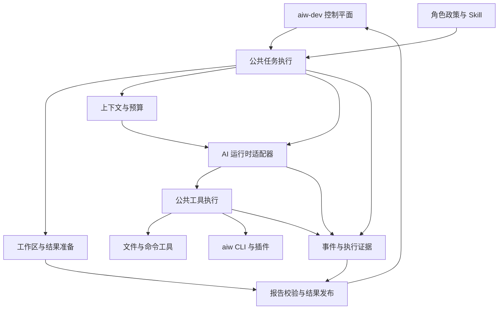

# Worker 公共执行基础与 pi 机制融合计划

本文规划各角色 Worker 共用的执行基础，并选择 pi 中适合融入 aiw-dev 的机制。目标是让需求分析、架构、规划、实现、集成、审查、验证和修复共享可靠的执行过程，同时通过角色政策表达不同职责。

本文保留 2026-10-04 的原始规划背景。后续 FD-009 已将两个 TypeScript Worker 合并到 `workers/process-typescript`，删除旧 API 包和启动路径；当前实现入口见 [统一 Worker](../workers/process-typescript/README.md)。aiw-dev 控制平面继续管理任务、调度、租约、模型授权、重试、审批和验收。pi 提供设计与算法参考，aiw 及其插件提供可选择的工具能力。

- 日期：2026-10-04
- 状态：待评审的整体计划，尚未实施本计划
- 范围：所有现有过程角色；API TypeScript 先落地，其他运行时分阶段对齐
- 依据：本地源码与文档静态检查
- 已接受约束：允许模型并行工具调用
- 相关评估：[aiw 能力复用报告](aiw-review.md)

## 当前基础与问题

现有角色通过 Profile 和 Skill 表达职责。API Worker 已实现 Worker Protocol、工作区、心跳、模型选择、工具权限和报告处理；其他过程 Worker 也有对应生命周期。

API Worker 当前已设置 `parallelToolCalls: true`，并为同一规范化路径的 `write`、`edit` 增加进程内队列。该变更只通过语法编译，SDK 并行调度、模型行为和端点兼容尚未运行验证。队列不协调 shell、其他进程或所有文件系统别名。

| 当前静态发现 | 对整体工作的影响 | 计划处理 |
|---|---|---|
| API Worker 的协议、工作区和执行编排集中在 `index.ts` | 生命周期与角色执行容易耦合，后续功能缺少统一落点 | 提取公共任务执行和工作区边界 |
| API 超时与任务取消主要覆盖 `ApiRuntime.execute` | 工作区准备和结果发布未纳入同一执行期限；租约丢失时收尾可能继续 | 建立从准备到发布的任务执行期限与取消处理 |
| 角色以 `readOnly` 和全局 shell 开关控制工具 | 验证证据、外部查询、受控命令等更细能力难以表达 | 引入按操作授权的角色执行政策 |
| 工具主要返回文本，日志主要记录名称 | 失败类型、执行状态和证据完整性难以稳定使用 | 统一工具结果、错误和事件 |
| 工具输出统一按字符保留前段 | 可能丢失命令末尾错误，无法精确表达已扫描范围 | 按工具用途截断并报告边界 |
| Skill 参考材料及上游报告整体展开 | 第一轮输入就可能很大，重复内容挤占执行空间 | 分层组装、材料目录、初始预算和可追溯引用 |
| 多种运行时有相似 Profile、Prompt 和报告逻辑 | 角色语义容易漂移；不能直接跨语言共享 TypeScript | 先统一行为契约与样例，再按语言实现 |

这些是代码组织和调用路径上的发现；取消竞争、SDK 行为和运行性能仍需专项验证。

## 完成后的行为

同一个任务进入公共执行流程后，角色只决定语义职责、可用能力、上下文选择和报告要求。



例如，Reviewer 和 Coder 共享相同的期限、事件、路径校验、输出限制与取消处理。Coder 可以使用编辑能力；Reviewer 使用只读能力，并根据代码版本及证据给出审查结论。切换角色不会创建另一套执行引擎。

## 公共职责与管理边界

| 层次 | 负责内容 | 处理原则 |
|---|---|---|
| 控制平面 | 任务状态、依赖、租约、Worker 容量、模型政策、重试、审批、工程验收 | 既有协议与管理方式作为基线 |
| 公共 Worker 基础 | 一次执行尝试、工作区、取消、预算、工具执行、上下文和证据 | 为各角色提供相同的执行保证 |
| 角色政策 | 职责、任务类型、能力集合、Skill、上下文偏好、报告要求 | 通过配置与少量语义适配表达 |
| AI 运行时 | 模型请求、工具回合、SDK 历史和流事件适配 | 首期使用现有 Agents SDK；其他运行时声明能力差异 |
| 外部工具 | 文件处理、指定命令、aiw 插件、外部系统操作 | 每个操作明确输入、输出和副作用，接受 Worker 政策约束 |

Worker 内部的执行阶段用于协调一次 attempt，不成为新的持久任务状态。工具事件和模型文本不能直接推进控制平面的审批或验收。

## pi 机制的融合选择

| pi 机制与源码 | 融合方式 | 适用角色 | 必须适配的差异 |
|---|---|---|---|
| Agent 状态与执行适配边界，`packages/agent/src/agent.ts` | 借鉴职责划分，为运行时设置小而明确的入口 | 全部 | aiw-dev 以 attempt 为单位，模型与重试受控制平面约束 |
| 工具执行前后钩子，`packages/agent/src/agent-loop.ts` | 统一校验、授权、执行、结果和事件处理 | 全部 | 租约丢失和权限失效必须终止，不能作为普通模型可修正错误 |
| 并行执行与按源顺序组织工具结果，`agent-loop.ts` | 比较现有 SDK 的行为，补足调度与关联契约 | 全部 | 保留已允许的并行调用；写入、shell 和外部副作用需资源协调 |
| 截断响应中的工具调用拒绝，`agent-loop.ts` | 核实 SDK 是否已有保护；缺失时在可检查的执行边界补充 | 全部 | 解析为 JSON 不足以证明参数完整，不执行尚未确认完整的调用 |
| 行数与 UTF-8 字节截断，`coding-agent/src/core/tools/truncate.ts` | 迁移适用的纯算法，调整限额和元数据 | 全部 | 模型摘要与完整执行证据分别管理，提示文字计入预算 |
| 多区域修改和编辑反馈，`tools/edit.ts`、`tools/edit-diff.ts` | 提取唯一性、重叠检查、换行和 diff 逻辑 | Coder、Integrator、Repairer | 首期保留精确匹配；模糊回退单独决策，保留现有路径政策 |
| 文件修改队列，`tools/file-mutation-queue.ts` | 借鉴等待 I/O 结束后释放的原则，完善资源协调 | 写入角色 | 队列不等于跨进程锁，也不能回滚已经发生的写入 |
| 用量估算、压缩触发和近期上下文保留，`core/compaction/compaction.ts` | 先加入预算与数据采集，再适配有界压缩 | 全部，按任务需求启用 | SDK usage 字段、中文估算、模型窗口和摘要成本不能照搬 |
| 明确的消息与执行事件 | 用于 task、attempt、turn、tool call 的关联 | 全部 | 首期不引入新数据库表；敏感内容和隐藏推理不进入常规事件 |

首期将上述机制融合到现有 Worker。采用 pi-agent-core 作为运行时是后续备选方案，只有现有 SDK 无法实现必要契约时才比较依赖与迁移成本。交互界面、会话树、自由切换模型和用户消息队列暂不进入公共 Worker 范围。

pi 的根许可为 MIT。直接迁移代码或实质性派生代码时，需要记录文件、源码版本或摘要，并保留适用的版权和许可声明；不能因未添加 npm 依赖就省略来源记录。

## 公共模块设计

首期建议在 API Worker 内形成以下模块。它们是设计目标名称，不要求一开始建立六个独立包。先按职责拆分，第二个实际使用者出现后再提取共享 TypeScript 库。

| 模块 | 对外提供的能力 | 内部承担的复杂性 |
|---|---|---|
| `AttemptRunner` | 执行一次已领取任务，返回可上报结果 | 心跳、执行阶段、取消原因、期限、资源结束与错误归类 |
| `WorkspaceSession` | 准备工作区、检查结果、发布及关闭 | Git 输入获取、版本校验、只读检查、提交、发布与清理 |
| `ContextAssembler` | 从任务和角色生成受预算约束的上下文 | 规则加载、Skill 版本、来源摘要、材料目录、引用与压缩 |
| `ToolHost` | 注册能力并执行一次工具调用 | 参数、授权、资源协调、取消、输出限制和错误分类 |
| `AgentExecution` | 以任务上下文和工具集合运行模型 | SDK 调用、回合限制、流事件、用量与运行时能力差异 |
| `EvidenceRecorder` | 记录有界事件与可校验结果引用 | 事件顺序、工具结果关联、敏感内容处理和证据摘要 |

角色政策和报告校验属于公共基础的输入与输出规则。API Worker 当前的 `profiles.ts`、`instructions.ts`、`ai-profiles.ts` 按上述职责逐步归位，保持现有配置可以启动。

不要建立要求所有运行时实现大量空方法的通用接口。Codex 自有工具循环由其运行时管理，无法提供的细节应声明为未知或不支持，不能伪造为 API Worker 的完整工具证据。

## 角色能力与报告矩阵

以下是建议目标。读写与执行能力按操作授予；Role 名称本身不是授权依据。

| 角色 | 公共上下文之外的重点 | 默认能力 | 报告与证据要求 |
|---|---|---|---|
| Requirements | 原始需求、来源与未决问题 | 读取、检索；授权后的外部需求查询 | 问题、范围、验收、来源和待确认项；保留现有语义报告契约 |
| Architect | 需求报告、现有边界与约束 | 读取、检索 | 方案、接口、风险、取舍和来源 |
| Planner | 需求、架构、依赖和实现约束 | 读取、检索 | 工作项与验收证据；兼容现有 manifest 解析 |
| Coder | 分配的工作项、基线与规范 | 读取、检索、编辑；单独授权命令 | 结果版本、变更文件、实现说明和执行证据 |
| Integrator | 多个上游结果、集成基线与契约 | 读取、检索、编辑；单独授权集成操作 | 集成版本、来源结果、冲突处理及验证证据 |
| Reviewer | 指定代码结果、规范与验收要求 | 读取、检索 | Findings 与证据，兼容 `AIW_VERDICT`；记录审查的确切版本 |
| Verifier | 验收场景、代码结果与已有测试证据 | 首期读取、检索 | 明确已执行与未执行、覆盖范围和决定性证据缺口 |
| Integration Verifier | 集成版本及跨工作项契约 | 首期读取、检索 | 集成场景、版本对应和证据缺口 |
| Repairer | Findings、失败证据与指定源结果 | 读取、检索、编辑；单独授权修复验证 | 修复对 Findings 的对应关系、结果版本和验证证据 |
| Release Readiness 与 Orchestrator | 保留现有 Skill 与 Profile | 目前不能作为可执行角色注册 | 缺少匹配的现有 TaskType；启用需独立控制平面设计 |

Verifier 的长期能力应由“是否允许验证操作”表达，而不是简单等同于只读。测试执行可能产生临时文件或使用服务，未来应给出命令、隔离目录和副作用政策。现有规则下仍不自动运行测试。

审查和验证材料不足时，报告必须明确缺口。是否导致 `REPAIR_REQUIRED` 或其他未来状态，应按当前契约评审；本计划不擅自新增协议 verdict 或改变验收含义。

## 生命周期与取消

建议的单次执行过程：

```text
领取任务 -> 校验角色与模型政策 -> start
  -> 准备工作区 -> 组装上下文 -> 执行模型和工具
  -> 校验报告与代码结果 -> 发布结果 -> complete
异常或取消 -> 停止新增副作用 -> 等待活动操作结束
  -> 按有效租约决定 fail -> 清理并记录结果
```

从领取后开始计算整体执行期限，API 请求、工具调用、上下文摘要与 Git 操作都受剩余时间约束。清理使用单独的有界期限，允许必要的资源收尾。

取消原因至少区分租约丢失、整体超时、操作超时和显式终止。进程 drain 表示停止领取并完成在途工作；强制中断属于另一种政策，不能混为一个布尔值。

发布前重新检查取消与所有权状态，发布后再确认是否允许回报。活动工具全部结束前不能删除工作区。不要通过超时竞争 Promise 的方式让底层写入继续、上层却认为已结束。

租约检查与外部 Git push 之间存在竞争窗口。Worker 内检查无法保证租约丢失时绝无远端写入。本阶段应停止新增操作、保留副作用证据，并让控制平面拒绝过期完成。若要求更强的发布保证，需要设计 attempt 独立发布引用或受控发布服务；其引用格式、权限与兼容性必须单独确认。

在实现前应检查当前控制平面的租约校验、complete/fail 幂等性和远端 publicationRef 契约。网络或上报失败也不能由 Worker 自行重跑整个任务；恢复与重试由控制平面决定。

## 并行工具与副作用

模型并行工具调用保持启用。Worker 的职责是协调资源，不把全部工具强制串行。

| 操作组合 | 目标行为 |
|---|---|
| 多个独立读取与查询 | 有界并行，结果按 tool call ID 关联 |
| 不同文件写入 | 允许并行，受总并发限制 |
| 同一文件的写入和编辑 | 在读改写全过程内按顺序执行，失败或取消后正确释放 |
| 同一文件读取与修改 | 定义一致性语义；需要最新结果时等待写入，不能假设并行读取是写入后的内容 |
| 写入与 shell | shell 不能声明可靠文件范围时，按工作区副作用协调；提示词只作为辅助 |
| Git 收尾与活动工具 | 收尾前等待所有活动工具结束 |
| 外部查询 | 按主体与服务额度设置并发上限 |
| 创建 Issue、发布、合并等外部写入 | 使用具体授权与幂等性政策；取消不意味着副作用已撤销 |

需要限制的是同时执行数量、输出累计量与资源冲突。写入顺序无法保证模型意图正确，重叠修改或基于旧内容的操作仍应被拒绝并返回可理解的冲突结果。

## 上下文和预算

上下文分为四层：控制平面与任务约束、角色 Skill、与当前任务相关的来源材料、近期执行历史。规则和验收要求始终显式保留，材料与工具输出作为数据处理。

第一步测量现有展开方式，记录初始输入、每轮新增工具输出和可获得的模型 usage。估算不能冒充精确用量；pi 的字符除以四启发式不保证适用于中文或所有模型，必须标记估算依据和未知字段。

按需加载的目标是保留必需的 Protocol、Primary Skill 和关键规则，给参考文件提供版本固定的目录及受控读取能力。当前冻结 Skill 的展开契约发生变化前，应确认哪些文件属于必需内容，不能悄悄省略。

历史压缩在基础预算建立后加入，必须满足：

- 不拆散尚未完成的工具调用与结果关联。
- 保留任务约束、关键决策、失败状态、文件变化和来源引用。
- 摘要标记为派生信息，不能成为人工确认或验收依据。
- 保留近期细节与可回查材料，并记录压缩前后输入大小。
- 摘要请求使用批准模型并占用同一任务期限和预算，有次数上限。
- 原始内容、摘要、模型及版本可追溯；记录政策控制敏感数据和保存期限。

模型窗口未知时使用明确的保守配置或停止条件。上下文、回合、时间、工具输出和并发分别设限。费用估算缺少可靠定价或 usage 时记录未知；首期不创建新的计费管理机制。

## 工具结果与执行证据

统一结果应包含状态、模型可见内容、截断信息及可选结构字段。完整输出引用、退出码、修改范围、耗时和错误类型由执行证据记录，不依赖模型再次转述。

普通可修正错误可以返回工具结果，让模型在同一个 attempt 中调整请求。租约丢失、无授权副作用或资源状态不确定时终止相应执行。两类情况使用不同的内部状态，再映射为当前协议支持的 failureCategory。

事件至少关联 task、attempt、role、turn 和 tool call。记录开始、结束、状态、耗时、截断与副作用范围；不默认写入完整提示词、密钥、仓库正文或隐藏推理。leaseToken 不进入工具输入、外部插件环境或常规日志。

首期记录在配置的工作区外、attempt 专属目录，使用有界日志及显式保存期限；避免证据文件被 `git add -A` 提交，或在工作区清理时全部丢失。事件存储是否影响执行要有明确政策：观察日志失败和必须保留的审批证据失败分别处理。

保持现有 Worker Protocol 报告字段和 verdict，新增内部证据先通过本地引用及兼容的报告内容表达。控制平面需要结构化存储时再设计协议版本、迁移和显示方式。

## aiw 插件的接入位置

aiw 插件通过 `ToolHost` 适配，各角色按操作取得能力。先盘点实际安装目录，内建命令和外部分发插件均纳入能力目录，不能从仓库未找到入口推断能力不存在。

首批候选是 Skills 查询及授权后的 GitHub 查询。文件补丁、代码索引、Skills 安装和外部交付写入按实际需要追加。

每项操作登记固定入口、插件版本或摘要、解释器、参数、输出格式、目录、网络及副作用。使用参数数组和有界输出，不把整个 aiw CLI 或任意插件发现机制直接交给模型。

插件输出只有通过 Worker 校验才能成为证据。FD 的管理状态不参与控制平面的任务推进。额外的包安装、网络、审批、持久化和发布操作仍服从 aiw-dev 的政策。

## 实施阶段与交付项

工作项编号仅用于本计划的依赖跟踪。实施前可转为项目认可的 FD 和 Work Items；本文不是已批准的 FD。

| 阶段 | 工作项 | 交付与可观察验收 | 依赖 |
|---|---|---|---|
| 一 契约与基线 | W01 角色和能力契约 | 现有可执行角色逐一映射；不支持角色明确拒绝；旧 Profile 可加载 | 无 |
| 一 契约与基线 | W02 SDK 与端点能力核对 | 基于实际安装依赖确认并行、取消、截断调用、usage、历史和钩子；形成支持矩阵与缺口 | W01 |
| 二 公共执行基础 | W03 AttemptRunner 与 WorkspaceSession | 生命周期从准备到发布统一期限；取消后停止新增副作用；活动操作结束后清理 | W01 |
| 二 公共执行基础 | W04 ToolHost 与资源协调 | 各角色通过同一执行边界；独立操作可并行；同文件与 shell 冲突行为明确 | W02、W03 |
| 二 公共执行基础 | W05 输出与编辑算法 | 行与字节预算、完整结构、分页提示；多区域校验后一次写入，格式保留，返回有界 diff | W04 |
| 三 上下文与证据 | W06 ContextAssembler 和初始预算 | 输入来源与 Skill 版本可追踪；超限明确处理；兼容必需 Skill 内容 | W01、W02 |
| 三 上下文与证据 | W07 事件、错误和结果校验 | tool call 与结果可关联；取消不伪装为成功；只读结果检查与现有报告保持兼容 | W03、W04、W05 |
| 三 上下文与证据 | W08 历史压缩 | 有界触发与摘要成本；工具关联、关键约束和来源保留；可回查原始材料 | W06、W07 |
| 四 角色与外部能力 | W09 全角色 API 验收 | 九个可执行角色分别覆盖成功、失败和能力拒绝；不同角色复用相同基础模块 | W03 至 W07 |
| 四 角色与外部能力 | W10 aiw 插件工具适配 | 固定插件身份、结构结果、取消、权限；查询先落地，副作用另行批准 | W04、W07 |
| 五 其他运行时 | W11 Codex TypeScript 对齐 | 复用可共享模块，明确无法观察的 SDK 内部行为；保持现有运行时注册与模型政策 | W09 |
| 五 其他运行时 | W12 Go 与 Python 对齐及运维文档 | 按共同契约实现；共享角色样例和验收场景；保留语言与运行时差异 | W11 |

旧 `codex-*` 参考 Worker 是否迁移，应在 W01 盘点中确定维护定位，避免自动把所有示例都升级为生产过程 Worker。demo-deployer 属于部署执行能力，需要单独的发布、权限与回滚设计。

首个可交付里程碑是 W01 至 W05 加 W07：完成公共生命周期和工具基础，仍使用现有上下文展开与 Agents SDK。第二个里程碑是 W06、W08、W09：完成上下文治理和全角色覆盖。第三个里程碑是 W10 至 W12：接入外部能力并对齐其他运行时。

W08 的自动摘要可以独立禁用，基础预算与错误处理仍应成立。其他 SDK 能力缺口只有阻碍必需契约时才触发运行时替换方案，不默认扩展为多 Provider 重构。

## 验收场景与证据

以下是计划中的检查场景，不表示已执行，也不授权自动运行测试、网络或模型调用。

| 范围 | 必须观察的场景 | 预期证据 |
|---|---|---|
| 角色 | 任务类型不匹配、只读角色请求写入、保留但不可执行角色 | 注册与执行拒绝记录，无未授权副作用 |
| 生命周期 | 准备、模型、工具和发布各阶段取消；超时；drain；complete 上报失败 | 取消原因、活动操作终态、清理记录和有效租约处理 |
| 发布 | 租约在 finalize 或 push 前后丢失 | 过期结果不被控制平面接受，已有副作用可追踪；不能声称绝无远端写入 |
| 并行 | 多读取、不同文件写入、同文件修改、失败后下一操作、等待期间取消 | tool call 关联，无丢失更新或提前清理；独立操作有并发证据 |
| shell | 与文件工具冲突、产生后代进程、超时和异常退出 | 资源协调和进程终态；按平台记录限制 |
| 编辑 | 多区域、重复匹配、重叠、BOM、CRLF、外部内容变化 | 全部校验后才写入；冲突拒绝与预期 diff |
| 输出 | 中文与多字节、长单行、首尾截断、搜索未完成、JSON 超限 | 预算含提示文字，完整结构或明确拒绝，截断范围明确 |
| 上下文 | 首轮超限、未知 usage、摘要取消、待完成工具调用、摘要后约束保留 | 输入组成、估算标记、压缩记录和合法调用历史 |
| 证据 | 工具失败被模型忽略、只读工作区变脏、缺少 verdict、日志写入失败 | 执行证据与最终文本分别校验，政策明确处理 |
| 插件 | 缺失入口、错误版本、非法输出、超时、无网络授权、外部写入重复请求 | 固定身份、失败类别和副作用记录 |
| 兼容 | 旧 Profile、旧 manifest、模型指导路径、其他运行时字段缺失 | 兼容样例通过，未知能力明确标记 |

优先使用离线、受控的假运行时和临时仓库验证确定性逻辑；SDK 集成、进程树和真实端点效果分开验证。测试和检查命令在对应工作项中列出精确范围并按仓库规则授权。

效果评估记录初始输入大小、模型回合、工具调用次数、耗时、输出截断率、可获得的 token 用量和取消后活动进程。使用相同任务与政策比较改造前后；未采集数据前不承诺提升百分比或固定成本下降。

## 兼容迁移与回滚

首期维持 Worker Protocol v1、角色名、现有环境配置、模型路径、规划 manifest 和 verdict。Profile 扩展需有默认映射和显式版本；不能通过新增字段使现有严格字段校验无提示失效。

按新的 Worker 身份小范围试运行，优先只读角色，再到编码、集成和修复。升级前 drain，在途任务结束后换包。Role、Skill 和运行时版本随注册或本地事件记录；不可观察字段标记未知。

回滚依赖旧包及配置仍可启动。受控新 Worker drain 或停止后，由控制平面处理未完成 attempt 和租约恢复；远端提交、Issue、评论等副作用需要对账，不能因为回滚包就假设已撤销。

本计划不自动修改数据库或控制平面 API。若发布保证、验证权限、证据存储或新增角色需要这些变更，应在相关工作项中补齐兼容、迁移与回滚设计。

## 实施前需要落实的决策

| 决策 | 本计划建议 | 何时必须明确 |
|---|---|---|
| 运行时 | 首期保留 Agents SDK，按能力缺口再比较 pi-agent-core | W02 结束 |
| 验证能力 | 首期保持只读证据检查；受控执行权限独立设计 | 开放验证命令前 |
| 外部结果发布 | 明确允许的副作用窗口；强保证另设设计 | W03 开始前 |
| Skill 加载 | 先测量现有输入，按需加载保留必需内容 | W06 改变展开方式前 |
| 证据保存 | attempt 目录、限额、访问与保存期限显式配置 | W07 开始前 |
| 不兼容端点 | 声明不支持并行能力或拒绝相应配置；不静默恢复全局串行 | W02 结束 |
| 公共代码分发 | 第二个实际使用者出现后提取库；跨语言共享契约和样例 | W11、W12 |

这些是实施决策门槛，不阻止完成整体计划。已授权的静态分析和文档工作可以继续，真正涉及政策变更时再针对具体方案确认。

## 源码依据与验证状态

aiw-dev 主要依据：

- [系统架构](current/02-SYSTEM-ARCHITECTURE.md)
- [统一 Worker 说明](../workers/process-typescript/README.md)
- [任务编排和工作区](../workers/process-typescript/src/index.ts)
- [API 运行时](../workers/process-typescript/src/api-runtime.ts)
- [工具与路径处理](../workers/process-typescript/src/tools.ts)
- [角色 Profile](../workers/process-typescript/src/profiles.ts)
- [上下文与报告](../workers/process-typescript/src/instructions.ts)
- [模型选择](../workers/process-typescript/src/ai-profiles.ts)
- [Codex TypeScript 上下文](../workers/process-typescript/src/instructions.ts)
- [Python Worker](../workers/process-python/process_worker.py)
- [Go Worker](../workers/process-go/main.go)

pi 主要依据：

- [Agent 状态与接口](../../pi/packages/agent/src/agent.ts)
- [执行循环与工具钩子](../../pi/packages/agent/src/agent-loop.ts)
- [工具与事件类型](../../pi/packages/agent/src/types.ts)
- [输出截断](../../pi/packages/coding-agent/src/core/tools/truncate.ts)
- [编辑工具](../../pi/packages/coding-agent/src/core/tools/edit.ts)
- [多区域编辑算法](../../pi/packages/coding-agent/src/core/tools/edit-diff.ts)
- [文件修改队列](../../pi/packages/coding-agent/src/core/tools/file-mutation-queue.ts)
- [上下文压缩](../../pi/packages/coding-agent/src/core/compaction/compaction.ts)
- [许可](../../pi/LICENSE)

本轮通过 `Get-Content`、`Get-ChildItem` 和 `rg` 静态读取源码与文档，仅新增计划并关联既有评估报告。没有运行 CLI、测试、类型检查、编译、构建、安装、网络或真实 API；计划中的运行时保证仍待上述验收场景验证。
